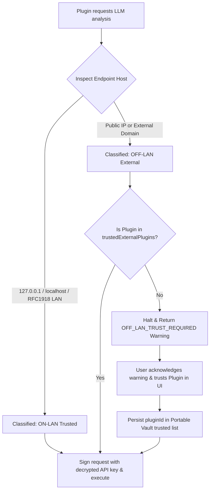
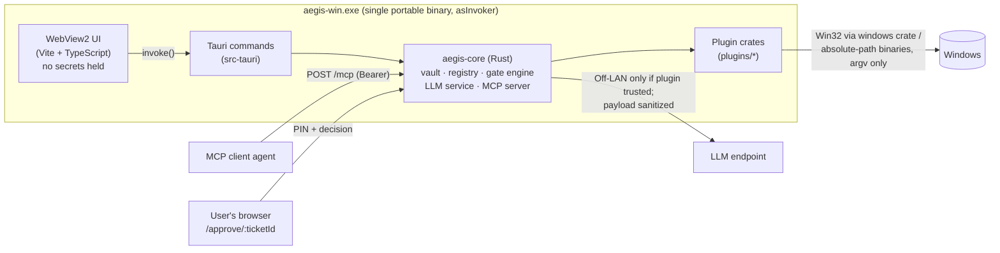

# AegisWin System Architecture & Design Plan

## 1. High-Level System Overview

**AegisWin** is a portable Windows utility built on **Tauri v2**. All core logic lives in the **Rust backend**: vault, plugin registry and gate policy engine, LLM service, MCP server, and the plugins themselves. A **Vite + TypeScript** webview UI is a presentation layer only. It has a compile-time modular plugin architecture, a central OpenAI-compatible LLM diagnostic service, and an authenticated HTTP MCP server with PIN-gated human approval.

> **Status**: the port from the Node.js prototype to Rust is complete and the prototype has been removed. See [ADR 0001](adr/0001-rust-core.md) for the decision and its amendment for what "basic functioning app" covers.

```
+-----------------------------------------------------------------------------------+
|                        AEGISWIN PORTABLE SINGLE EXECUTABLE                        |
|                                                                                   |
|  +-----------------------------------------------------------------------------+  |
|  |                 HIGH-CONTRAST DYNAMIC-SCALE DARK UI (Vite)                  |  |
|  |  [Startup PIN Gate]  [First-Run Plugin Wizard]  [Dynamic Zoom: 85% - 150%]  |  |
|  |  [Plugin Workspace]  [Off-LAN LLM Trust Modal]  [Live MCP Approval Queue]   |  |
|  +--------------------------------------+--------------------------------------+  |
|                                         | IPC / Internal Bridge                   |
|  +--------------------------------------v--------------------------------------+  |
|  |                      COMPILE-TIME PLUGIN REGISTRY & ENGINE                  |  |
|  |                                                                             |  |
|  |  +---------------------+  +----------------------+  +--------------------+  |  |
|  |  | plugins/event-logs  |  | plugins/win-health   |  | plugins/usage-mon  |  |  |
|  |  | - query_logs (auto) |  | - flush_dns (pin)    |  | - cpu_ram_spikes   |  |  |
|  |  | - filter_id  (auto) |  | - ip_renew  (pin)    |  | - crash_correlator |  |  |
|  |  | - analyze_ai (auto) |  | - sfc_scan  (pin+adm)|  | - active_window    |  |  |
|  |  |                     |  | - winsock   (pin+adm)|  |                    |  |  |
|  |  +---------------------+  +----------------------+  +--------------------+  |  |
|  +----------+---------------------------+---------------------------+----------+  |
|             |                           |                           |             |
|  +----------v-----------+   +-----------v------------+   +----------v----------+  |
|  |  PORTABLE VAULT      |   |  CENTRAL LLM SERVICE   |   |  LOCAL MCP SERVER   |  |
|  | ./data/vault.enc.json|   |  - Ollama / LM Studio  |   |  - Bearer Key Auth  |  |
|  |  - Argon2id KDF      |   |  - OpenAI Compatible   |   |  - Auto Firewall    |  |
|  |  - AES-256-GCM Keys  |   |  - RFC1918 LAN Check   |   |  - /mcp JSON-RPC    |  |
|  |  - Zero-Knowledge PIN|   |  - Per-Plugin Trust    |   |  - /approve/:ticket |  |
|  +----------------------+   +------------------------+   +---------------------+  |
+-----------------------------------------------------------------------------------+
```

## 2. Core Data Flows & Sequence Diagrams

### 2.1 MCP Tool Call & PIN-Gated Web Approval Flow
When an AI agent connects to the local MCP HTTP server (`POST /mcp`), every tool call passes through the **Per-Tool Gate Policy Engine**:

```mermaid
sequenceDiagram
    participant Agent as External AI Agent (MCP Client)
    participant MCP as AegisWin MCP Server (:47821)
    participant Gate as Tool Gate Policy Engine
    participant Portal as Local Approval Web Page (/approve/:id)
    participant User as Human Operator

    Agent->>MCP: POST /mcp (Bearer Token) -> tools/call "windows-health__winsock_reset"
    MCP->>Gate: Check install state, schema, admin, then gate policy
    alt Tool Policy == "auto"
        Gate->>MCP: Execute tool immediately
        MCP-->>Agent: 200 OK { content, structuredContent, isError: false }
    else Tool Policy == "pin_required"
        Gate->>MCP: Create ticket (128-bit id, CSRF token, 30-minute expiry)
        MCP-->>Agent: 200 OK { status: "pending_approval", ticketId, approvalUrl: "http://127.0.0.1:47821/approve/{ticketId}" }
        User->>Portal: Opens the approvalUrl (or approves in the AegisWin app)
        Portal-->>User: No-script page: tool, arguments, PIN, note, Approve/Decline
        User->>Portal: POST /approve/{ticketId} { csrf, decision: "approve", comment: "Proceed before reboot", pin }
        Portal->>Gate: Check PIN through the global PIN guard (never stored in the ticket); 3 wrong PINs lock the ticket
        Gate->>Gate: Re-check install state, then run "windows-health__winsock_reset" in the background (status: running)
        Agent->>MCP: POST /mcp -> tools/call "aegis__check_ticket" { ticketId }
        MCP-->>Agent: 200 OK { status: "approved", userComment: "Proceed before reboot", result: {...} }
    end
```

### 2.2 Central LLM Service & Per-Plugin Off-LAN Trust Flow



### 2.3 Long-Running Approved Tools (`sfc /scannow`)
An approved ticket moves to `running` and the tool runs on a background task, so the approval page and the app return at once. The agent polls `aegis__check_ticket` until the status is final: `approved` (with the result), `execution_failed`, `declined`, `locked_out`, or `expired`. There is no progress percentage; `sfc /scannow` reports only its final result.

### 2.4 Process & Trust Layout



- The PIN crosses the webview→Rust boundary only as an argument of the one command that needs it (unlock, a gated run, an approval, a gate or trust change) and is never stored in JS state. Approval PINs from the browser portal go straight to the Rust HTTP handler. See [SECURITY_MODEL §2.1](SECURITY_MODEL.md).
- The UI receives display data only: no API keys, no bearer tokens, no derived keys.

## 3. Directory Structure
```
aegis-win/
├── Cargo.toml                  # Workspace: src-tauri, crates/aegis-core, plugins/*
├── crates/
│   └── aegis-core/             # engine (single enforcement point), vault + PIN guard, registry + gate policy,
│                               # approval tickets, LLM service + sanitizer, MCP server + /approve portal, OS layer
├── plugins/<plugin-id>/        # One crate per plugin: Cargo.toml, manifest.json, src/lib.rs, README.md, tests/
├── src-tauri/                  # Thin app binary: async Tauri commands, window setup, build.rs, app.manifest (asInvoker),
│                               # tauri.conf.json (CSP), capabilities/default.json, icons/
├── src/ui/                     # Plain TypeScript UI (invoke-only, DOM via text nodes, no framework)
├── index.html                  # Vite entry for src/ui/main.ts
├── scripts/ci-runner.mjs       # npm run ci: Node repo tests, tsc, vite build, cargo test --workspace
├── documentation/              # Specs, ADRs, audit ledger
└── tests/                      # Node tests for repo, docs, and UI/Tauri wiring invariants (Rust tests live beside their crates)
```
