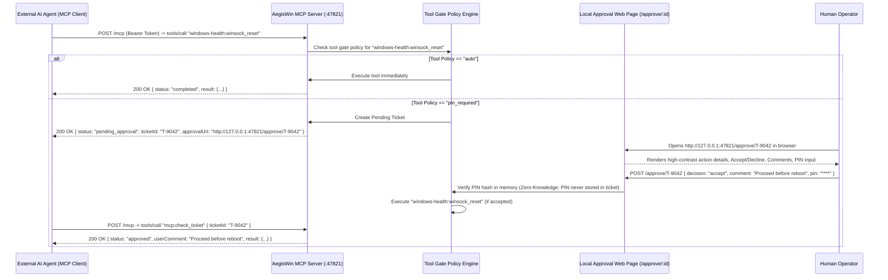
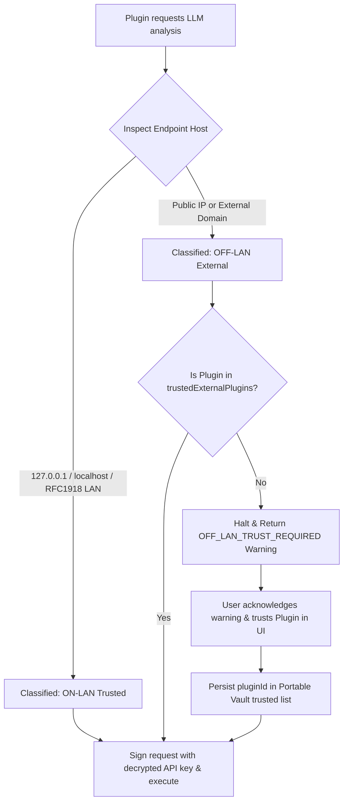
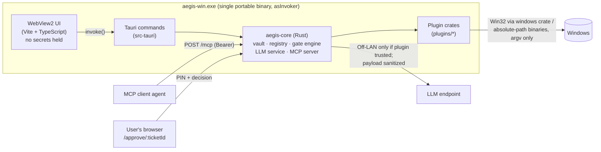

# AegisWin System Architecture & Design Plan

## 1. High-Level System Overview

**AegisWin** is a portable Windows utility built on **Tauri v2**. All core logic lives in the **Rust backend**: vault, plugin registry and gate policy engine, LLM service, MCP server, and the plugins themselves. A **Vite + TypeScript** webview UI is a presentation layer only. It has a compile-time modular plugin architecture, a central OpenAI-compatible LLM diagnostic service, and an authenticated HTTP MCP server with PIN-gated human approval.

> **Migration status**: the core is being ported from a Node.js prototype (`src/core/*.mjs`, `plugins/*/index.mjs`) to Rust, one module per PR. See [ADR 0001](adr/0001-rust-core.md) for the decision, the target layout, and the port order. The diagrams below describe the target design. Until a module is ported, its JS prototype and tests are the behavioral spec.

```
+-----------------------------------------------------------------------------------+
|                        AEGISWIN PORTABLE SINGLE EXECUTABLE                        |
|                                                                                   |
|  +-----------------------------------------------------------------------------+  |
|  |                 HIGH-CONTRAST DYNAMIC-SCALE DARK UI (Vite)                  |  |
|  |  [Startup PIN Gate]  [First-Run Plugin Wizard]  [Dynamic Zoom: 85% - 150%]  |  |
|  |  [Plugin Workspace]  [Off-LAN LLM Trust Modal]  [Live MCP Approval Queue]   |  |
|  +--------------------------------------+--------------------------------------+  |
|                                         | IPC / Internal Bridge                   |
|  +--------------------------------------v--------------------------------------+  |
|  |                      COMPILE-TIME PLUGIN REGISTRY & ENGINE                  |  |
|  |                                                                             |  |
|  |  +---------------------+  +----------------------+  +--------------------+  |  |
|  |  | plugins/event-logs  |  | plugins/win-health   |  | plugins/usage-mon  |  |  |
|  |  | - query_logs (auto) |  | - flush_dns (pin)    |  | - cpu_ram_spikes   |  |  |
|  |  | - filter_id  (auto) |  | - ip_renew  (pin)    |  | - crash_correlator |  |  |
|  |  | - analyze_ai (auto) |  | - sfc_scan  (pin+adm)|  | - active_window    |  |  |
|  |  |                     |  | - winsock   (pin+adm)|  |                    |  |  |
|  |  +---------------------+  +----------------------+  +--------------------+  |  |
|  +----------+---------------------------+---------------------------+----------+  |
|             |                           |                           |             |
|  +----------v-----------+   +-----------v------------+   +----------v----------+  |
|  |  PORTABLE VAULT      |   |  CENTRAL LLM SERVICE   |   |  LOCAL MCP SERVER   |  |
|  |  (./data/vault.enc)  |   |  - Ollama / LM Studio  |   |  - Bearer Key Auth  |  |
|  |  - Scrypt/Argon2 KDF |   |  - OpenAI Compatible   |   |  - Auto Firewall    |  |
|  |  - AES-256-GCM Keys  |   |  - RFC1918 LAN Check   |   |  - /mcp JSON-RPC    |  |
|  |  - Zero-Knowledge PIN|   |  - Per-Plugin Trust    |   |  - /approve/:ticket |  |
|  +----------------------+   +------------------------+   +---------------------+  |
+-----------------------------------------------------------------------------------+
```

## 2. Core Data Flows & Sequence Diagrams

### 2.1 MCP Tool Call & PIN-Gated Web Approval Flow
When an AI agent connects to the local MCP HTTP server (`POST /mcp`), every tool call passes through the **Per-Tool Gate Policy Engine**:



### 2.2 Central LLM Service & Per-Plugin Off-LAN Trust Flow



### 2.3 Asynchronous Job Streaming for Long-Running Tools (`sfc /scannow`)
When a slow administrative command is approved on `/approve/:ticketId` with `asyncExecution: true`, the HTTP handler transitions the ticket to `status: "running"` (`progressPercent: 15..100`) and spawns a non-blocking worker so the browser tab never hangs and the MCP agent can poll `mcp:check_ticket` for completion.

### 2.4 Process & Trust Layout (Target)



- The PIN crosses the webview→Rust boundary in exactly one command (`unlock_vault`) and is never stored in JS state. Approval PINs go from the browser portal straight to the Rust HTTP handler.
- The UI receives display data only: no API keys, no bearer tokens, no derived keys.

## 3. Directory Structure

### 3.1 Target (Rust core, per ADR 0001)
```
aegis-win/
├── Cargo.toml                  # Workspace: src-tauri, crates/*, plugins/*
├── crates/
│   └── aegis-core/             # vault, PIN KDF, registry + gate policy, LLM service + sanitizer,
│                               # MCP server + /approve portal, elevation job bridge
├── plugins/<plugin-id>/        # One crate per plugin: Cargo.toml, manifest.json, src/lib.rs, README.md, tests/
├── src-tauri/                  # Thin app binary: Tauri commands, wiring, --elevate-tool mode
├── src/ui/                     # TypeScript UI (invoke-only), Tailwind compiled at build time
├── documentation/              # Specs, ADRs, audit ledger
└── tests/                      # JS tests for UI/docs/repo invariants (Rust tests live beside their crates)
```

### 3.2 Current (Node.js prototype being ported)
```
aegis-win/
├── AGENT.md
├── CLAUDE.md
├── package.json
├── vite.config.ts
├── scripts/
│   └── ci-runner.mjs
├── documentation/
│   ├── ARCHITECTURE.md
│   ├── AUDIT_LEDGER.md
│   ├── GUIDING_PRINCIPLES.md
│   ├── PLUGIN_SPEC.md
│   └── SECURITY_MODEL.md
├── src/
│   ├── core/
│   │   ├── vault.mjs           # Portable Argon2/Scrypt + AES-256-GCM encrypted store
│   │   ├── llm-service.mjs     # Central LLM client + LAN/Off-LAN detector + plugin trust gate
│   │   ├── plugin-registry.mjs # Compile-time plugin loader, first-run wizard state, tool gating
│   │   └── mcp-server.mjs      # HTTP MCP server, auto-firewall port manager, /approve/:id portal
│   └── ui/
│       └── app-shell.mjs       # High-contrast dark UI state & dynamic scale controller
├── plugins/
│   ├── event-logs/             # Windows Event Log Explorer & AI log analyzer
│   ├── windows-health/         # SFC scan, DNS flush, IP release/renew, Winsock reset
│   └── usage-monitor/          # Modular resource spikes, crash correlator, active window tracker
├── src-tauri/
│   ├── Cargo.toml
│   ├── Cargo.lock              # Pinned Rust dependency tree (committed for reproducible builds)
│   ├── build.rs                # tauri-build; embeds app.manifest in place of Tauri's default
│   ├── tauri.conf.json
│   ├── app.manifest            # Windows UAC asInvoker manifest (+ Common Controls v6)
│   ├── icons/                  # app-icon.svg source + generated icon.ico / PNGs (`npx tauri icon`)
│   └── src/
│       └── main.rs             # Rust native bridge, firewall rule helper, UAC self-elevation
└── tests/
    └── *.test.mjs              # Core & architectural verification test suites
```
